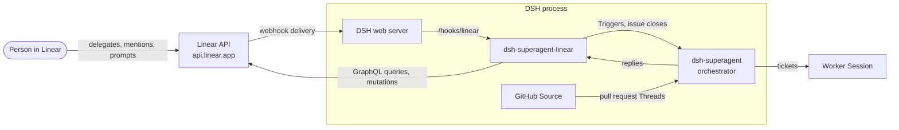
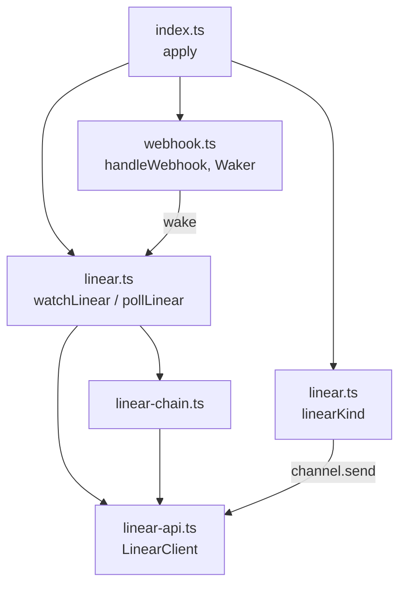
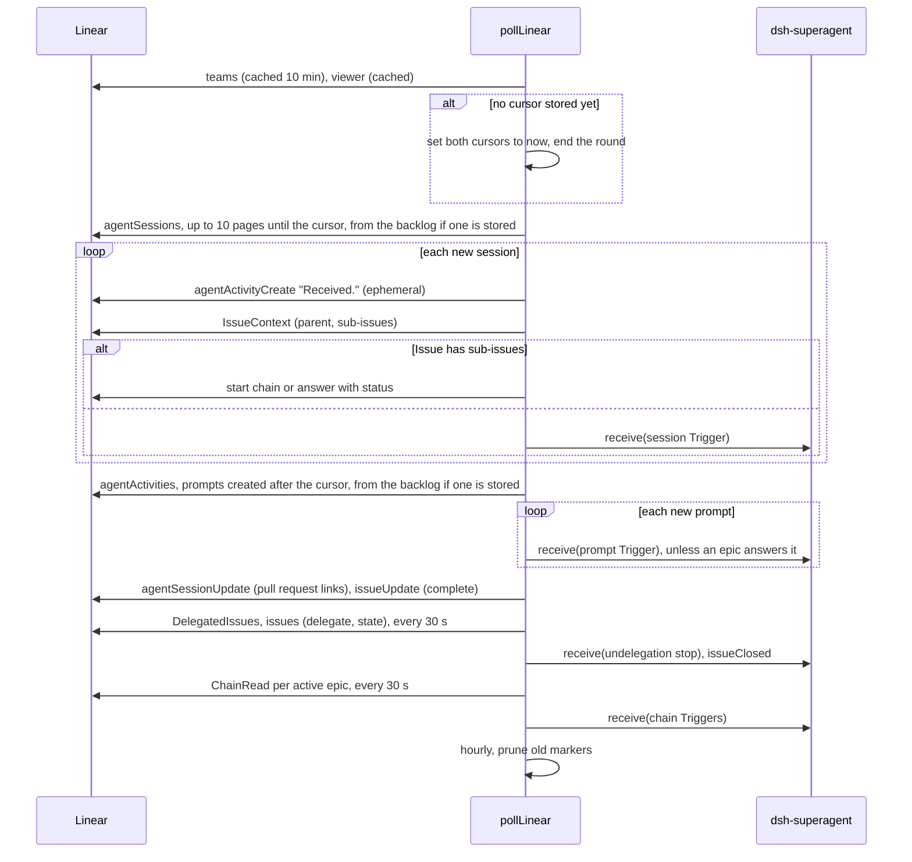
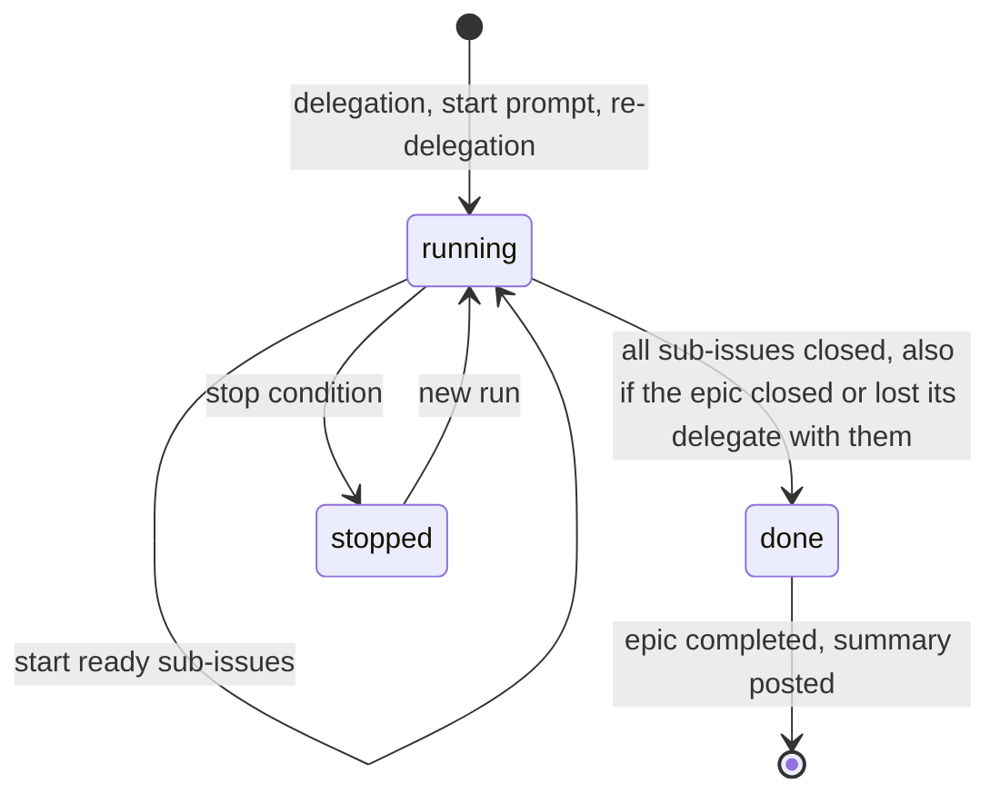

# Architecture

dsh-superagent-linear is a cordis plugin for DSH. It registers one Source kind, `linear`, with dsh-superagent and runs a polling loop against Linear's GraphQL API. It holds no database of its own: all state goes through the Source context dsh-superagent provides.

## Context

The plugin depends on the GitHub Source in two ways. It routes an Issue only to a repository the GitHub Source serves. It learns about pull requests and merges from the GitHub Threads a ticket follows.

## Components

| File | Role |
| --- | --- |
| `src/index.ts` | Plugin entry. Registers the Source kind, starts the polling loop, and registers the webhook route when DSH offers the optional `webServer` service. |
| `src/linear.ts` | The Source kind: config schema, panel fields, Policy, admission rows, Channel, execution environment. Also the polling round (`pollLinear`), Trigger builders, routing, pull request links and issue-close checks, and the loop (`watchLinear`). |
| `src/linear-chain.ts` | Chain mode: starting runs, advancing chains, stopping them, answering prompts and mentions on epics, and detecting re-delegation. |
| `src/linear-api.ts` | `LinearClient`: token handling, rate-limit hold, GraphQL operations, idempotent activity creation. |
| `src/webhook.ts` | `handleWebhook` checks a delivery. `Waker` ends the loop's wait early. |
| `src/types.ts` | The parts of dsh-superagent's Source interface the plugin uses, written out structurally. |

`index.ts` runs the loop inside a cordis effect. Disposing the plugin aborts the loop and unregisters the kind. DSH ends its process on an unhandled rejection, so an error that escapes the loop becomes the Source's health instead.

## The loop

`watchLinear` waits for dsh-superagent to be ready. When the deployment is not configured, it reports `paused` and exits. Otherwise it repeats:

1. Read the current config. Report `paused` when the Source is off, a credential file is unset, or no team is enabled.
2. Run one round with `pollLinear`.
3. Report health: `ready`, or `error` when teams are skipped or unknown.
4. Wait `pollSeconds`, or less when the webhook woke it.

A failed round counts as a failure. Three in a row make health `error`. A refused token or a rate limit makes it `error` at once, as no request can succeed until it passes.

## A round

### Sessions

For each session after the cursor, the round:

1. Skips sessions the chain opened itself, and sessions the app created.
2. Routes the Issue to a repository (see [Routing](#routing)). A misrouted or unmapped Issue gets one `error` activity and is left out.
3. Posts the ephemeral "Received." thought once per session.
4. Reads the Issue context (parent and up to 30 sub-issues) once per new Trigger.
5. For an Issue with sub-issues: a person's delegation, without a comment from a person, starts a chain when `admits` lets that person; otherwise it gets the refusal. A person's mention gets the chain status. Nothing else follows.
6. For a new session whose context could not be read: holds it for up to 10 minutes by failing its take-in, then posts an error and drops it. Unknown sub-issues could make the Issue an epic, which never gets a worker of its own.
7. Otherwise adds the context header, applies split mode, and calls `receive`.

### Prompts

For each prompt after the cursor, the round finds an open ticket on the same Issue. With one, the prompt follows that ticket's team and repository. Without one, it is routed like a session; a misrouted or unmapped prompt gets one `error` activity. A routed prompt on an epic goes to the chain logic first. An exact `start` from an admitted person may start a run, a stop from one ends it, and anything else gets the status or the refusal instead of a Trigger.

A `receive` that answers `duplicate` is not counted in the round's sessions or prompts.

### Cursors

A cursor holds back only when taking in an item threw: `receive` failed, an activity post failed, or a hold for unreadable sub-issues. Items that are skipped on purpose (own sessions, misrouted, unmapped or unlisted Issues) do not hold it.

Each query reads at most 10 pages of 25. When the read stops at that limit with older pages left, the round stores a backlog `{ after, newest }` instead of moving the cursor. The next round reads on from `after` with the same cursor. Once a read reaches the cursor, the backlog is cleared and the cursor moves past the newest item of all those reads. A backlog is dropped only when Linear refuses its page cursor as invalid input; the read then starts from the newest page again. Other errors, such as a token wait or a server error, leave it in place. The next cursor is five seconds before the newest item read, to catch writes Linear records late, and never moves back. Fixed Trigger ids make the overlap harmless. A round in which an item was not taken in throws after finishing the other steps, so the next round reads it again.

### Routing

`routeOf` gives one of four results for a Trigger:

| Result | When | Effect |
| --- | --- | --- |
| `unlisted` | No enabled team matches. | Passed to `receive`. The scope filter in dsh-superagent drops it. |
| `unmapped` | The team matches, but neither the project entry nor the team names a repository. | Not taken in. One `error` activity per session or prompt. |
| `misrouted` | The named repository is not one the GitHub Source serves. | Not taken in. One `error` activity per session or prompt. Listed in health as "left out". |
| `served` | The repository is served. | Taken in. A non-primary repository goes into `meta.repository`. |

## Chains

A chain record per epic is stored under `linear-chain:<epic id>`:

| Field | Meaning |
| --- | --- |
| `run` | Id of what started the run: the session, the prompt, or the history entry of a re-delegation. Starting the same run twice is a no-op. |
| `session` | The epic's session, where plans, status and results go. Empty when a re-delegation found none. |
| `delegator` | The person whose Triggers the sub-issues carry. |
| `status` | `running`, `stopped` or `done`. |
| `started` | Per sub-issue: its session, Trigger and ticket. |
| `checked` | When the epic was last read. |
| `reason` | Why the chain stopped. |
| `team`, `teamKey`, `project`, `projectName` | The epic's team and project when the run started. |
| `identifier`, `url` | The epic's identifier and page. |
| `delegated` | The epic was delegated to the app. Only then does losing the delegation stop the chain. |
| `children` | The sub-issues seen at the last read. |
| `delegation` | When a re-delegation started the run. A new session on the epic within 2 minutes joins that run. |
| `waiting` | The sub-issues the last "Waiting for …" notice named. |

`advanceChains` reads each running epic at most every 30 seconds, or at once when a sub-issue's ticket ended. `chainParallel` caps started sub-issues across all chains. A started sub-issue counts while it has an open ticket, a Trigger without a ticket yet, or an ended ticket whose Issue is still being completed.

When nothing is running or ready and only sub-issues assigned to someone else are open, the epic's session gets one "Waiting for …" notice per distinct set (stored in the record's `waiting`). A `blocks` relation whose blocker Linear does not return counts as an open blocker.

A chain record is written as `done` before the epic is completed. A crash in between completes it on the next round.

## Stored state

All keys live in the Source context's state store.

| Key | Holds |
| --- | --- |
| `linear-sessions-cursor`, `linear-prompts-cursor` | Intake cursors. |
| `linear-seen:<session or prompt>` | The session was answered, or the misrouted or unmapped session or prompt was refused. |
| `linear-sessions-backlog`, `linear-prompts-backlog` | Where a read cut at the page limit continues. |
| `linear-follow-failed:<ticket>:<what>` | First failure time and count of a pull request link or Issue completion. |
| `linear-pruned` | The last pruning. |
| `linear-linked:<session>:<url>` | The pull request link was added. |
| `linear-completed:<ticket>` | The Issue was completed after a merge. |
| `linear-followed-tickets` | Tickets whose pull requests are followed. |
| `linear-delegation`, `linear-delegation-checked` | Delegate state per ticket and the last check time. |
| `linear-closing-tickets` | Tickets whose Issue is watched for a close. |
| `linear-chain:<epic>`, `linear-chains` | Chain records and the active list. |
| `linear-chain-sessions` | Sessions the chain opened, kept 14 days. |
| `linear-chain-run:<id>` | A session, prompt or history entry was handled by the chain logic. |
| `linear-chain-held:<id>` | When a session or prompt with unreadable sub-issues was first held. |
| `linear-watched` | Issues the Source saw a session or ticket on, with Linear's creation time of the newest session read, kept 14 days. |
| `linear-delegated-checked` | The last re-delegation check. |
| `linear-redelegations` | Re-delegations of Issues without sub-issues waiting to start, with the session opened for each. |

Once an hour, the round drops `linear-seen:`, `linear-chain-run:`, `linear-completed:`, `linear-chain-held:`, `linear-follow-failed:` and `linear-linked:` markers older than 14 days. Markers of tickets still followed are kept. A marker stored without a time gets the current time and ages from then. Pruning needs a host whose state store lists keys (`state.keys`).

## Integration with dsh-superagent

The kind uses these parts of dsh-superagent's Source interface:

- `scope`: a Trigger is listened to when an enabled team matches. The admission row is the team's name.
- `channel.allowed`, `channel.send`, `channel.link`: replies go to the session. The link is the Channel's `url`: the agent session's URL for a session Trigger (the Issue's page when Linear gives none), the new session's URL for a chain Trigger, and the Issue's page for a prompt Trigger.
- `find`: Issue identifiers such as `ENG-12` in a search query become search terms.
- `policy`: the allowed list of Linear user ids, and one admission row per enabled team, marked "Sessions only".
- `environment`: the variables listed in [Configuration](configuration.md#execution-environment).
- `accountFields`: the three file paths. Only the panel and the plugin configuration may change them.
- `admits`: optional, from dsh-superagent `e16b265`. Whether the Policy lists a person; it gates starting and stopping chains. Without it nobody can.
- `tickets.issueClosed`: optional. On a host without it, the Source does not watch Issues for closes.
